# 记账宝 · JiZhangBao

> 一句话记账的智能记账应用 · Spring Boot 3 + Spring AI + Vue 3 全栈实践

[](https://spring.io/projects/spring-boot)
[](https://spring.io/projects/spring-ai)
[](https://vuejs.org/)
[](https://vant-ui.github.io/vant/)
[](https://element-plus.org/)
[](https://www.mysql.com/)
[](https://redis.io/)
[](LICENSE)

**记账宝**是一款面向个人用户的智能记账应用。它把「记账」这件事压缩成一句话：输入「昨天午饭花了 30」，
系统自动识别**金额、分类、时间、支付方式**并落账；每月自动生成消费分析报告，指出异常与趋势并给出可执行的省钱建议。

项目包含三端：

| 端 | 技术 | 说明 |
| --- | --- | --- |
| 服务端 | Spring Boot 3.5 · MyBatis-Plus · Spring AI · MySQL · Redis | REST API + SSE 流式问答 + 定时任务 |
| 移动端 | Vue 3 · Vant 4 · Pinia · ECharts | 手机尺寸的记账 App，含 AI 助手对话 |
| 后台端 | Vue 3 · Element Plus · Pinia · ECharts | PC 管理端 + 平台数据看板 |

---

## 界面预览

### 移动端（Vant 4）

| 首页 | 记一笔 | AI 助手问答 |
| --- | --- | --- |
|  |  | 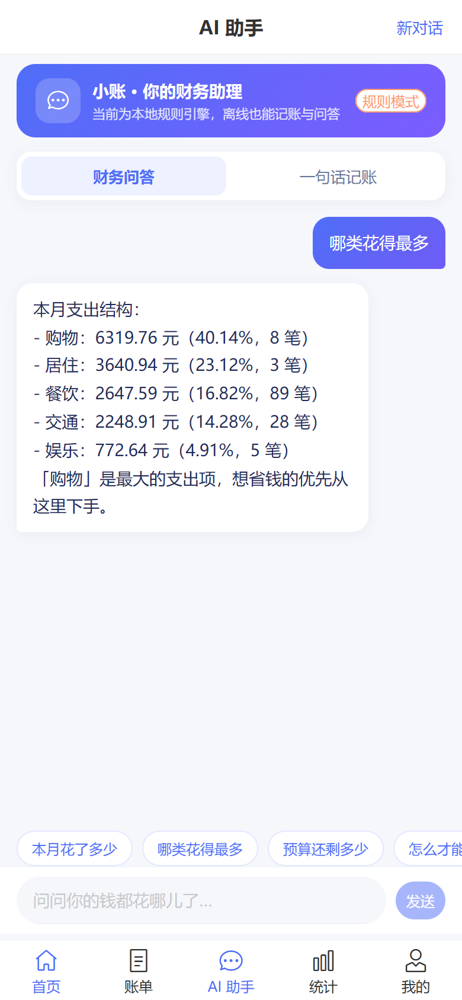 |

| 一句话记账 | 账单明细 | 统计分析 |
| --- | --- | --- |
|  | 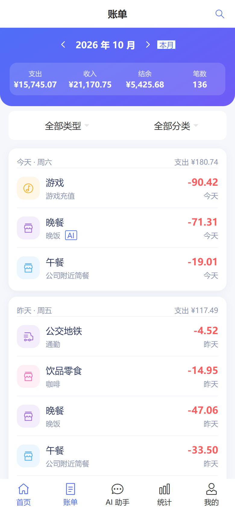 | 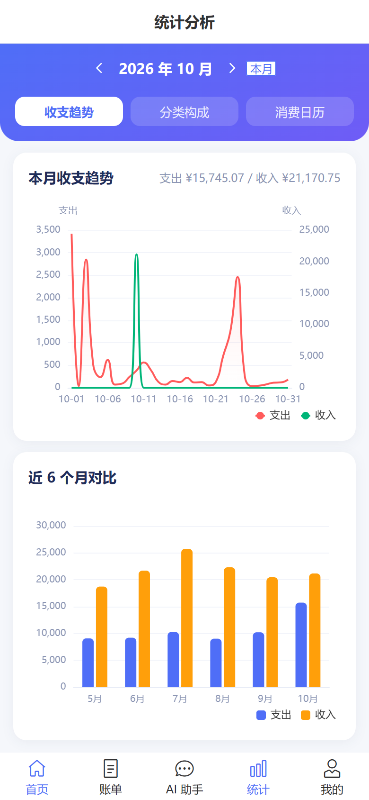 |

| 预算提醒 | 消费洞察 | 登录 |
| --- | --- | --- |
| 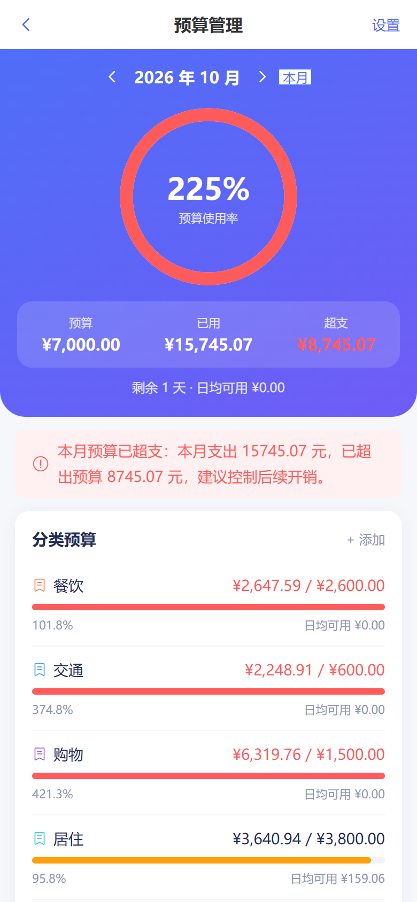 | 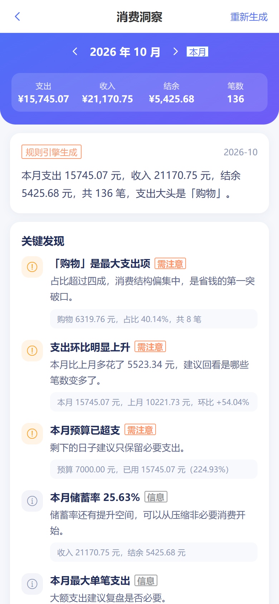 |  |

### PC / 后台端（Element Plus）

| 数据概览 | 账单管理 |
| --- | --- |
| 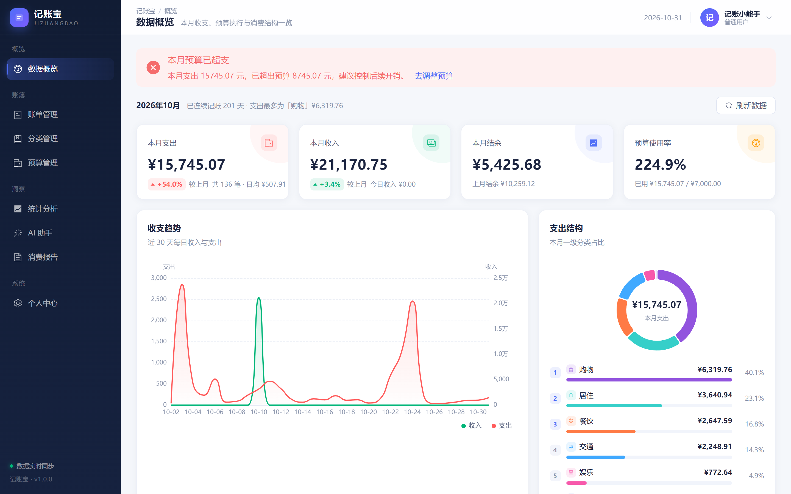 | 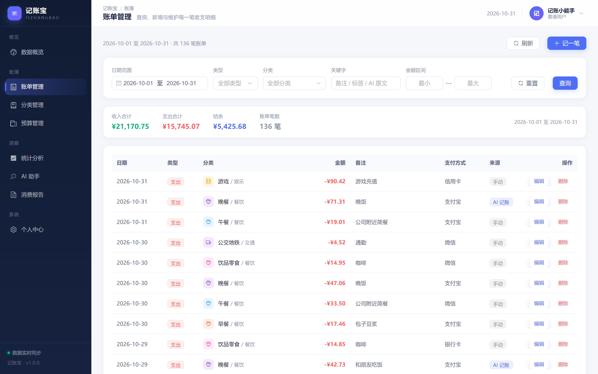 |

| 统计分析 | AI 助手 |
| --- | --- |
| 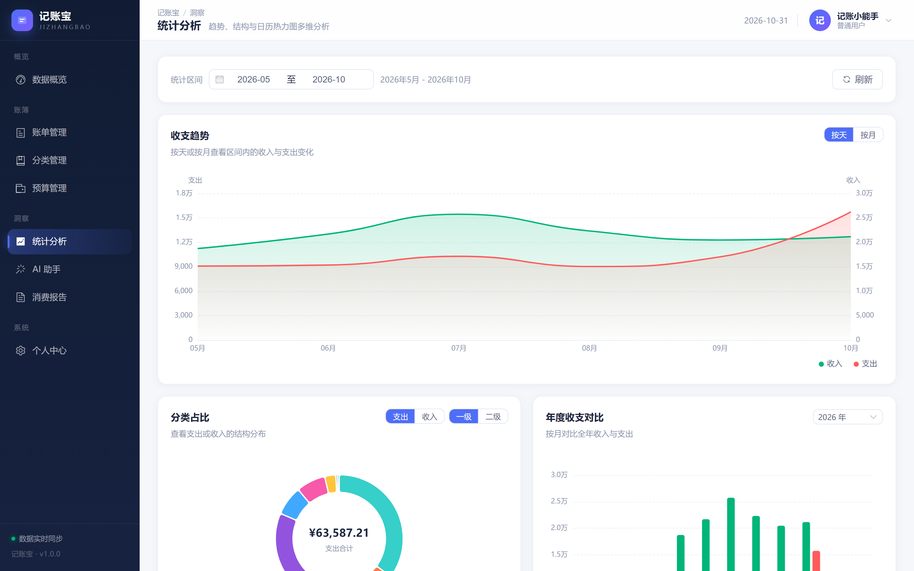 | 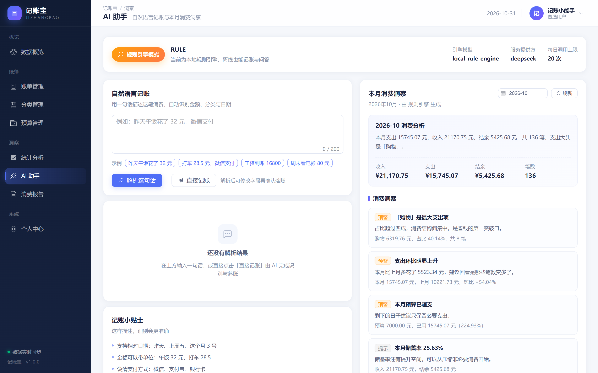 |

| 预算管理 | 消费报告 |
| --- | --- |
| 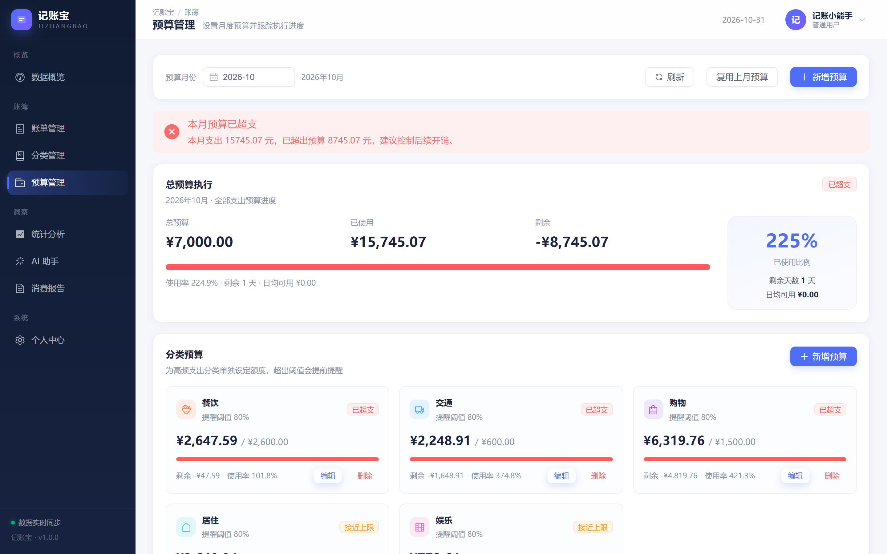 | 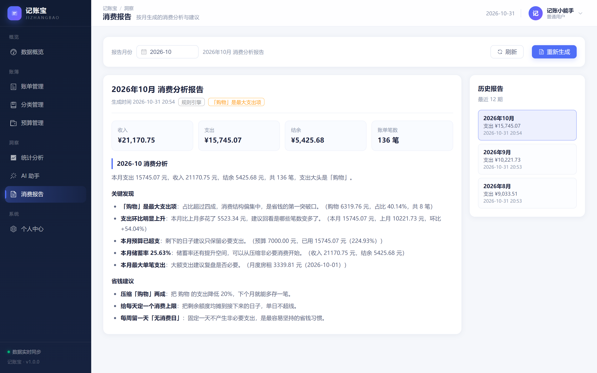 |

| 平台概览（ADMIN） | 用户管理（ADMIN） |
| --- | --- |
| 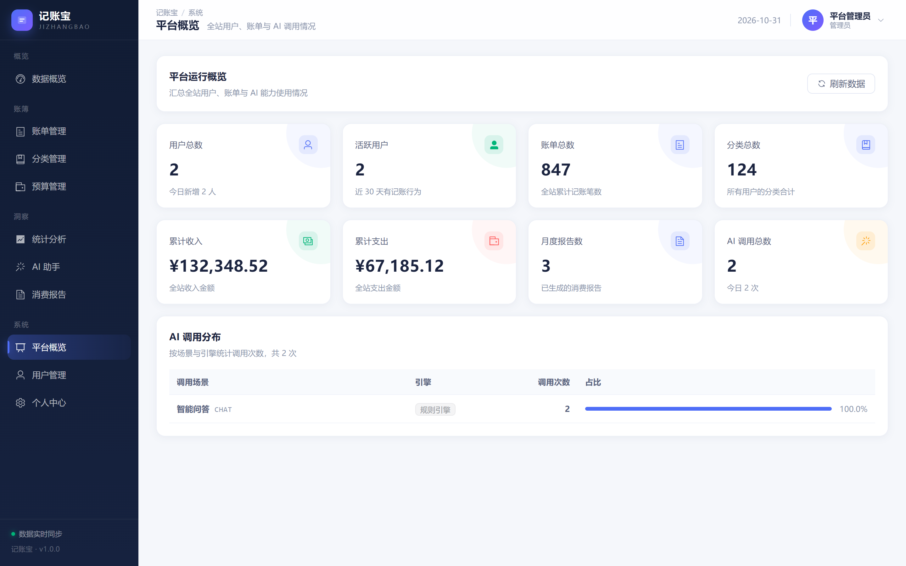 | 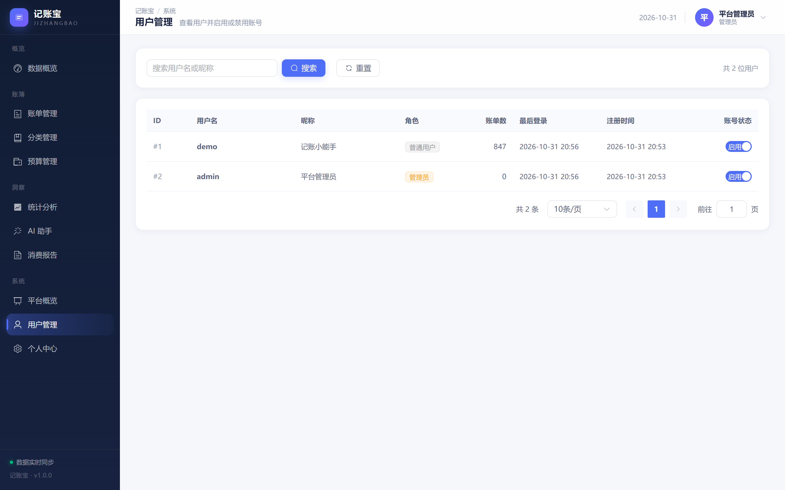 |

---

## 功能特性

### 1. 记账与统计

- **快速记账**：收入 / 支出双向记账，数字键盘、分类宫格、日期与支付方式一屏完成。
- **多级分类**：内置 15 个一级分类 / 60+ 二级分类（餐饮、交通、购物、居住、娱乐……），支持自定义增删改，系统分类受保护。
- **明细检索**：按日 / 月 / 年切换，支持类型、分类、关键字、金额区间、支付方式多维筛选与分页。
- **图表统计**：收支趋势（按天 / 按月自动降采样）、分类占比（一级 / 二级）、年度 12 月对比、每日支出热力日历。
- **概览看板**：本月收支结余、环比、日均支出、连续记账天数、支出大头一目了然。

### 2. AI 记账助手

- **自然语言记账**：`昨天午饭花了 30，用微信付的` → `支出 / 午餐 / 30.00 / 2026-10-30 / 微信`。
  - 支持中文数字（「午饭三十块」）、相对日期（今天 / 昨天 / 前天 / 上周五 / 6月15日）、支付方式识别、收入意图识别（发了工资、报销、退款）。
  - 解析结果返回**置信度**与待确认提示，前端可先改分类再落账。
- **财务问答**：SSE 流式输出，「本月花了多少 / 哪类花得最多 / 预算还剩多少 / 怎么才能省点钱」都有数据支撑的回答。
- **双引擎设计**：`llm` 模式走 Spring AI 调用大模型；`rule` 模式走内置规则引擎，**离线也能完整演示**。大模型异常时自动降级，记账入口永不失效。

### 3. 消费洞察与预算

- **月度报告**：每月 1 日凌晨定时为所有用户生成上月报告（也可手动触发 / 实时生成），包含消费结构、环比变化、储蓄率、最大单笔等关键发现与省钱建议。
- **预算管理**：月度总预算 + 分类预算，展示已用 / 剩余 / 日均可用 / 剩余天数，达到阈值推送提醒（Redis 去重，同类提醒一天只出现一次）。
- **复用上月预算**：一键把上月预算复制到本月。

### 4. 后台管理

- 平台概览：用户数、账单数、累计收支、AI 调用量、今日新增。
- 用户管理：检索、启用 / 禁用、账单数统计。
- AI 调用分布：按场景（记账解析 / 问答 / 洞察）与引擎统计，便于观察降级情况。

---

## 技术栈

**服务端**

| 组件 | 版本 | 用途 |
| --- | --- | --- |
| Spring Boot | 3.5.6 | Web / 事务 / 定时任务 / 异步 |
| Spring AI | 1.1.8 | 大模型接入（OpenAI 兼容协议） |
| MyBatis-Plus | 3.5.7 | ORM、分页插件、逻辑删除、自动填充 |
| MySQL | 8.0+（实测 9.1） | 业务数据 |
| Redis（Lettuce） | 5.0+ | 缓存、AI 解析结果复用、限流、Token 黑名单、报告生成锁 |
| JJWT | 0.12.6 | JWT 签发与校验 |
| springdoc-openapi | 2.8.9 | Swagger / OpenAPI 3 文档 |
| Lombok | - | 样板代码 |

**前端**

| 组件 | 用途 |
| --- | --- |
| Vue 3.5 + `<script setup>` | 组合式 API |
| Vite 6 | 构建与开发服务器 |
| Pinia 3 | 状态管理 |
| Vue Router 4 | 路由与登录守卫 |
| Vant 4 | 移动端组件库 |
| Element Plus 2.9 | PC / 后台组件库 |
| ECharts 5.6 | 折线、柱状、饼图、仪表盘、日历热力 |
| Axios | HTTP 客户端（统一拦截器） |

---

## 系统架构

```
┌────────────────────────┐        ┌────────────────────────┐
│  web-mobile (Vant 4)   │        │  web-pc (Element Plus) │
│  记账 / 统计 / AI 对话  │        │  看板 / 管理 / 后台     │
└───────────┬────────────┘        └───────────┬────────────┘
            │  /api (axios + JWT)             │
            └───────────────┬─────────────────┘
                            ▼
        ┌──────────────────────────────────────────┐
        │           jizhangbao-server              │
        │  ┌────────────────────────────────────┐  │
        │  │ JwtAuthInterceptor → AuthContext   │  │
        │  └────────────────────────────────────┘  │
        │  ┌─────────┬─────────┬────────┬───────┐  │
        │  │  bill   │  stats  │ budget │ report│  │
        │  ├─────────┴─────────┴────────┴───────┤  │
        │  │      ai (engine: LLM / RULE)       │  │
        │  │  parse · chat(SSE) · analysis      │  │
        │  └────────────────────────────────────┘  │
        └───────┬───────────────────────┬──────────┘
                │                       │
        ┌───────▼────────┐      ┌───────▼────────┐
        │     MySQL      │      │     Redis      │
        │ 7 张业务表      │      │ 缓存/限流/黑名单 │
        └────────────────┘      └────────────────┘
                │
        ┌───────▼────────────────────────────────┐
        │  Spring AI ChatClient (OpenAI 兼容)     │
        │  DeepSeek / 通义千问 / OpenAI / vLLM    │
        └────────────────────────────────────────┘
```

### 关键设计

**1. AI 记账的三段式链路**

```
自然语言 ──► AiEngine.parseBill ──► ParsedBill(结构化) ──► 分类映射与兜底 ──► BillParseVO ──► 用户确认落账
```

- `AiEngine` 是抽象接口，`SpringAiEngine`（大模型）与 `RuleBasedAiEngine`（规则）实现同一契约；
- 大模型只负责**语义抽取**，分类必须落在用户自己的分类集合内（提示词里给出候选集），避免"编"出不存在的分类；
- 任何异常都降级到规则引擎，保证 `/api/ai/bills/record` 永远可用。

**2. 让大模型"言之有数"**

`FinanceContextBuilder` 每次提问前把用户当月真实聚合数据渲染成中文上下文（收入/支出/结余/分类排行/预算/最大单笔），
模型只做表达、不做计算 —— 从机制上杜绝数字幻觉。离线模式下同一份快照交给 `LocalAnswerGenerator` 按意图生成回答。

**3. 统计全部下推数据库**

趋势、分类占比、月度对比、区间合计都写成 MySQL `GROUP BY` 聚合（`BillMapper.xml`），
Java 层只负责补齐连续坐标轴（空日期补 0）与环比/占比计算，避免把明细拉到应用侧再算。

**4. Redis 的四个真实用途**

| 用途 | Key | TTL |
| --- | --- | --- |
| 首页概览缓存（写账单主动失效） | `jzb:stats:overview:{uid}:{month}` | 60s |
| AI 解析结果复用（同一句话不重复烧 token） | `jzb:ai:parse:{uid}:{md5}` | 1h |
| AI 接口限流（每分钟 20 次） | `jzb:rate:ai:{uid}:{minute}` | 2min |
| 登出 Token 黑名单 / 预算提醒去重 / 报告生成锁 | 见 `CacheKeys` | 各自不同 |

> 缓存是加速手段而非强依赖：`CacheHelper` 捕获所有 Redis 异常，Redis 挂掉时业务自动回源，接口不受影响。

---

## 快速开始

### 环境要求

- JDK 17+
- Maven 3.8+
- Node.js 18+
- MySQL 8.0+
- Redis 5.0+（可选，缺失时自动降级为不回源缓存）

### 方式一：Docker 起依赖 + 本地跑应用（推荐）

```bash
# 1. 起 MySQL + Redis
docker compose up -d

# 2. 起后端（默认 dev profile，自动建表 + 写入演示数据）
cd server
mvn spring-boot:run
# 或 mvn clean package -DskipTests && java -jar target/jizhangbao-server.jar

# 3. 起移动端
cd ../web-mobile
npm install && npm run dev      # http://localhost:5174

# 4. 起后台端
cd ../web-pc
npm install && npm run dev      # http://localhost:5175
```

### 方式二：全部本地原生启动

```bash
# 创建数据库（表结构由应用启动时自动执行 schema.sql）
mysql -uroot -p -e "CREATE DATABASE jizhangbao DEFAULT CHARACTER SET utf8mb4;"

# 如密码/端口不同，用环境变量覆盖
export MYSQL_USER=root MYSQL_PASSWORD=yourpassword MYSQL_PORT=3306
export REDIS_HOST=localhost REDIS_PORT=6379

cd server && mvn spring-boot:run
```

### 访问地址

| 服务 | 地址 |
| --- | --- |
| 移动端 | http://localhost:5174 |
| PC / 后台 | http://localhost:5175 |
| 后端 API | http://localhost:8080/api |
| 接口文档 (Swagger UI) | http://localhost:8080/doc.html |
| 健康检查 | http://localhost:8080/api/meta/health |

### 演示账号

| 账号 | 密码 | 角色 | 说明 |
| --- | --- | --- | --- |
| `demo` | `123456` | 普通用户 | 首次启动自动生成近 200 天约 800 条演示账单 + 预算 + 历史报告 |
| `admin` | `123456` | 管理员 | 可进入后台管理端 |

> 演示数据由 `DemoDataInitializer` 幂等写入：已有数据时自动跳过，不会重复插入。
> 关闭方式：`--jizhangbao.demo.enabled=false`。

### 接口自测

仓库自带一份零依赖的冒烟验收脚本（Node 18+ 原生 `fetch`），后端起来后直接跑：

```bash
node scripts/api-smoke.mjs
# 自定义地址：node scripts/api-smoke.mjs http://127.0.0.1:8080/api
```

覆盖 9 组共 **56 条断言**：公共元数据、认证与鉴权、分类、账单、统计、预算、
AI 能力（语义解析 / 一句话落账 / SSE 流式问答 / 消费洞察）、月度报告、后台管理。
退出码 `0` 表示全部通过。

```text
================ 验收结果 ================
  PASS: 56    FAIL: 0
==========================================
```

---

## 接入真实大模型

默认以 `rule` 模式运行（零外部依赖、可离线演示）。接入大模型只需三步：

```bash
export OPENAI_API_KEY=sk-xxxxxxxxxxxx
export OPENAI_BASE_URL=https://api.deepseek.com   # 或 https://dashscope.aliyuncs.com/compatible-mode
export OPENAI_MODEL=deepseek-chat

java -jar target/jizhangbao-server.jar --spring.profiles.active=llm
```

任何兼容 OpenAI 协议的服务都可以：DeepSeek、通义千问（compatible-mode）、Moonshot、本地 vLLM / Ollama(OpenAI 兼容层)。

提示词模板放在 `server/src/main/resources/prompts/*.st`，把提示词当配置而非硬编码：
`ai-bill-parse.st`（记账解析）、`ai-chat.st`（财务问答）、`ai-analysis.st`（结构化洞察）、`ai-report.st`（报告正文）。

---

## 目录结构

```
记账宝/
├── server/                          # Spring Boot 服务端
│   ├── src/main/java/com/jizhangbao/
│   │   ├── common/                  # Result / 异常 / 枚举 / 工具（日期、中文数字、缓存）
│   │   ├── config/                  # MyBatis-Plus / Redis / Jackson / CORS / 异步 / 演示数据
│   │   ├── security/                # JWT、登录拦截器、线程级登录上下文
│   │   └── module/
│   │       ├── user/                # 注册登录、资料、密码
│   │       ├── category/            # 多级分类 + 关键词匹配器
│   │       ├── bill/                # 账单 CRUD 与多维筛选
│   │       ├── stats/               # 概览 / 趋势 / 分类 / 月度对比 / 日历
│   │       ├── budget/              # 预算与超支提醒
│   │       ├── report/              # 月度报告 + 定时任务
│   │       ├── ai/                  # 引擎（LLM/RULE）、记账、问答、洞察、提示词
│   │       └── admin/               # 后台管理
│   └── src/main/resources/
│       ├── application.yml          # 主配置
│       ├── application-dev.yml      # 开发环境
│       ├── application-llm.yml      # 大模型环境
│       ├── db/schema.sql            # 建表脚本（启动自动执行）
│       ├── mapper/BillMapper.xml    # 统计聚合 SQL
│       └── prompts/*.st             # 提示词模板
├── web-mobile/                      # 移动端（Vue 3 + Vant 4）
│   └── src/{api,components,layouts,router,stores,styles,utils,views}
├── web-pc/                          # PC / 后台端（Vue 3 + Element Plus）
│   └── src/{api,components,config,layouts,router,stores,styles,utils,views}
├── docs/
│   ├── API.md                       # 接口文档
│   ├── ARCHITECTURE.md              # 架构与设计决策
│   └── DEPLOY.md                    # 部署说明
├── screenshots/                     # 界面截图
├── docker-compose.yml               # MySQL + Redis
└── README.md
```

---

## 数据模型

| 表 | 说明 |
| --- | --- |
| `t_user` | 用户（BCrypt 密码、角色、状态） |
| `t_category` | 收支分类，两级结构，`is_system` 标记内置分类 |
| `t_bill` | 账单，冗余 `parent_category_id` 以支持按大类聚合 |
| `t_budget` | 月度预算（`category_id = 0` 表示总预算） |
| `t_monthly_report` | 月度消费分析报告（Markdown 正文 + 洞察/建议 JSON） |
| `t_ai_conversation` / `t_ai_message` | AI 会话与消息 |
| `t_ai_usage_log` | AI 调用日志（场景、引擎、耗时），用于后台统计与降级观察 |

> 注意：`YEAR_MONTH`、`SYSTEM` 在 MySQL 中是保留字，因此列名使用 `bill_month`、`is_system`，
> 实体上用 `@TableField` 映射回语义化的 Java 字段名。

---

## 工程约定

- **统一响应**：`{ code, message, data, timestamp }`，`code = 0` 表示成功；401 返回 HTTP 401。
- **异常处理**：业务异常 `BizException(ErrorCode)` → `GlobalExceptionHandler` 统一转换，参数校验自动汇总提示。
- **逻辑删除**：所有业务表带 `deleted`，MyBatis-Plus 全局接管，SQL 层统计语句手动带上 `deleted = 0`。
- **越权防护**：所有按 ID 取数据的入口都校验 `userId` 归属（`getOwned`），后台接口额外要求 `ADMIN` 角色。
- **时间格式**：Jackson 全局 `yyyy-MM-dd HH:mm:ss` / `yyyy-MM-dd`，避免时间戳歧义。

---

## Roadmap

- [ ] 账单导入（支付宝 / 微信账单 CSV）
- [ ] 多账户与资产账户余额联动
- [ ] 周期性账单（房租、订阅）自动生成
- [ ] 预算按周维度
- [ ] 语音记账（前端录音 + ASR）
- [ ] 单元测试覆盖 AI 解析与统计聚合

---

## 许可

[MIT](LICENSE) © 2025 记账宝
